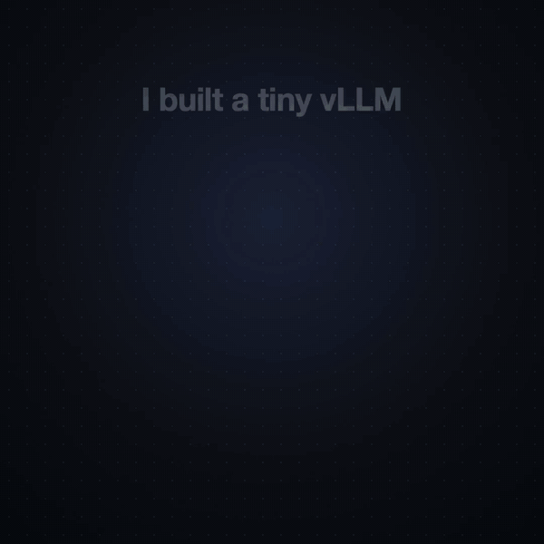
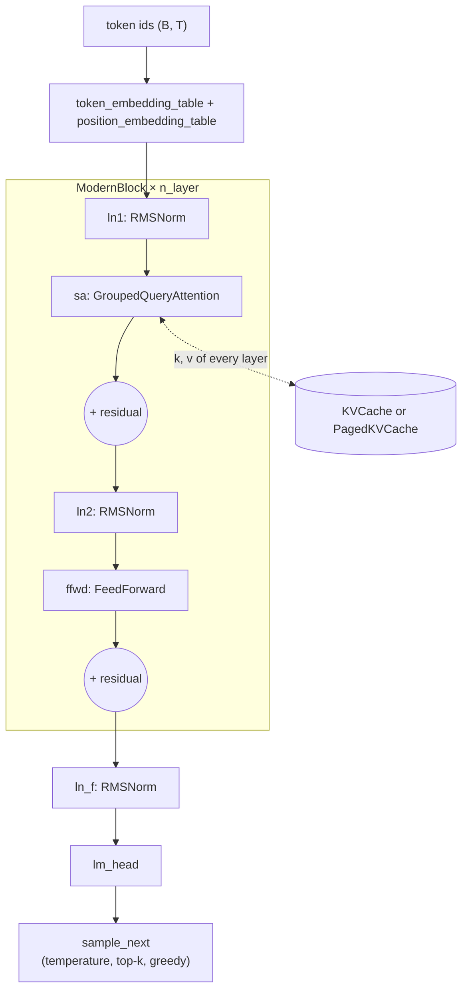
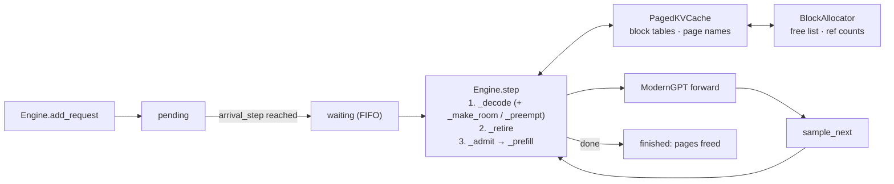
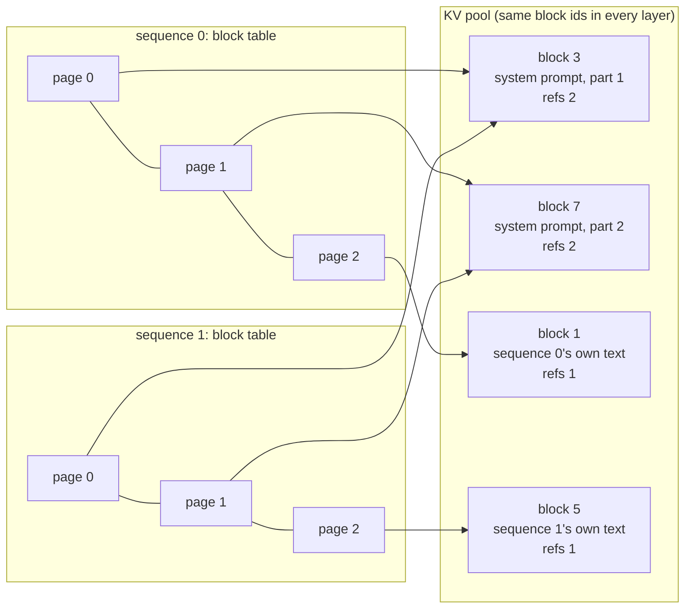
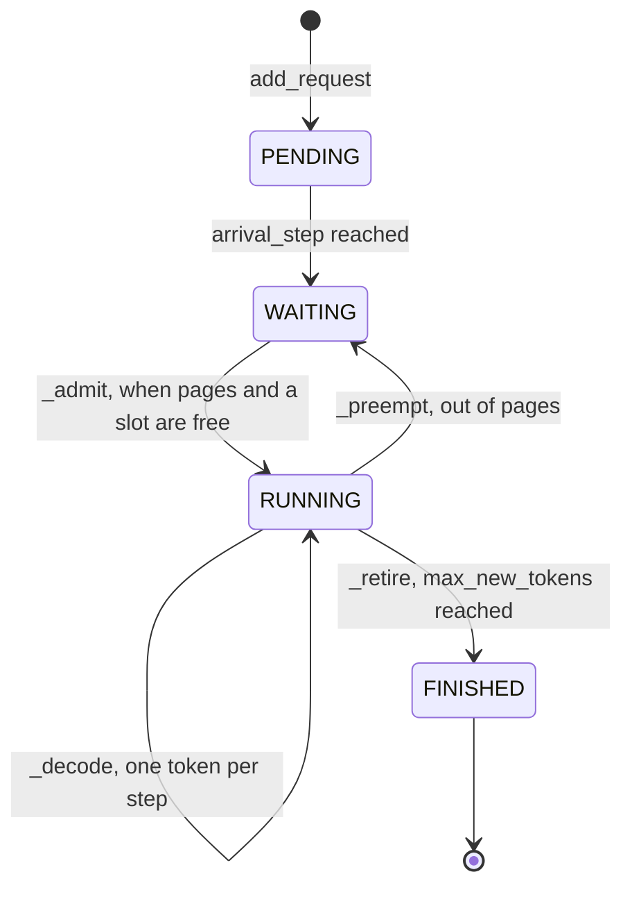
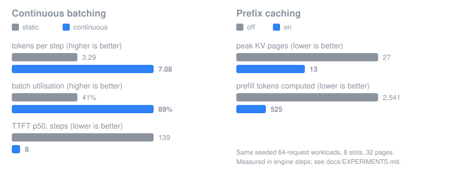

<div align="center">

# pico-vllm

**Learn how an LLM works, and why serving it efficiently matters, by reading a tiny one built from scratch.**<br/>
A character-level GPT, then a mini-vLLM to serve it: KV cache → paged KV → continuous batching → prefix caching. Plain PyTorch, runs on a Mac.

[](https://github.com/Analyst-Harsh/pico-vllm/actions/workflows/ci.yml)




</div>

> ✅ **Complete.** The model and the engine are both done, every piece is tested against a simple reference, and every number below links to the experiment that produced it.

## 🎯 Who this is for

You know some Python and PyTorch and want to see what's underneath tools like vLLM: how a GPT predicts the next token, and why serving many users at once is mostly a memory-management problem. Each file is short and teaches one idea. Along the way you'll see:

- **Attention:** each token asks a question (query), compares it with every earlier token's key, and averages their values. Four versions of it, each checked against the one before.
- **A GPT:** stack attention and a small MLP with residuals and norms, train it on Shakespeare, and loss drops from 2.49 (bigram) to 1.585, then to 1.497 at 9.6M parameters.
- **Llama-style blocks:** RMSNorm and grouped-query attention. GQA keeps the quality and halves the KV cache.
- **The KV cache:** a token's keys and values never change, so store them. 128× less work for a 250-letter reply, and the same text.
- **Paged KV memory:** hand out memory a page at a time instead of reserving the longest possible reply.
- **Continuous batching:** schedule every step, not every batch, so a finished request's slot is refilled at once.
- **Prefix caching:** requests that start with the same system prompt share its pages instead of recomputing them.

## 🧭 Learning path

Read top to bottom. Each row is one idea, the file that implements it, the test that proves it works, and what it measured.

| # | Concept | Problem it solves | Read | Proof | Result |
|---|---|---|---|---|---|
| 1 | Tokens and batches | text → numbers a model can learn from | [`data.py`](src/pico_vllm/data.py) | [`test_data.py`](tests/test_data.py) | — |
| 2 | Bigram and one head | the simplest next-character models | [`model/baselines.py`](src/pico_vllm/model/baselines.py) | [`test_baselines.py`](tests/test_baselines.py) | val loss [2.49](docs/EXPERIMENTS.md#2026-11-01-bigram-baseline-on-tiny-shakespeare-f4) → [2.41](docs/EXPERIMENTS.md#2026-11-01-one-attention-head-vs-bigram-f4) |
| 3 | Attention, four ways | let tokens look at their past; then do it fast | [`model/attention.py`](src/pico_vllm/model/attention.py) | [`test_attention.py`](tests/test_attention.py) | batched heads [1.34× faster](docs/EXPERIMENTS.md#2026-11-10-batched-heads-vs-looped-heads-f6-step-1) than looped, same maths |
| 4 | A GPT | stack attention + MLP into a transformer | [`model/gpt.py`](src/pico_vllm/model/gpt.py), [`sampler.py`](src/pico_vllm/sampler.py) | [`test_gpt.py`](tests/test_gpt.py), [`test_sampler.py`](tests/test_sampler.py) | val loss [1.585](docs/EXPERIMENTS.md#2026-11-02-run-b-wider-gpt--ctx-64-dropout-02-vs-0-f5); [1.497 at 9.6M params](docs/EXPERIMENTS.md#2026-11-12-a-96m-param-model-with-256-context-and-the-kv-cache-on-it) |
| 5 | Llama-style blocks | RMSNorm; GQA for a smaller KV cache | [`model/llama_style.py`](src/pico_vllm/model/llama_style.py) | [`test_llama_style.py`](tests/test_llama_style.py) | GQA: [KV cache 4 KB → 2 KB per token](docs/EXPERIMENTS.md#2026-11-10-gqa-n_kv_head-4--2--1-f6-step-3), val within noise |
| 6 | Training | fit every model above, keep the best checkpoint | [`train.py`](src/pico_vllm/train.py) | — | see rows 2–5; the 9.6M model [peaks at step 2,000, then overfits](docs/EXPERIMENTS.md#2026-11-12-a-96m-param-model-with-256-context-and-the-kv-cache-on-it) |
| 7 | KV cache | stop recomputing the whole prefix for every token | [`serving/kv_cache.py`](src/pico_vllm/serving/kv_cache.py) | [`test_kv_cache.py`](tests/test_kv_cache.py) | [2,016 → 63 positions](docs/EXPERIMENTS.md#2026-11-11-kv-cache-vs-recompute-v9-b1) through the model for 63 tokens; [32,625 → 255 for 250](docs/EXPERIMENTS.md#2026-11-12-a-96m-param-model-with-256-context-and-the-kv-cache-on-it) on the 9.6M model |
| 8 | Paged KV | stop reserving `ctx_len` slots per request | [`serving/block_allocator.py`](src/pico_vllm/serving/block_allocator.py), [`serving/paged_kv_cache.py`](src/pico_vllm/serving/paged_kv_cache.py) | [`test_block_allocator.py`](tests/test_block_allocator.py), [`test_paged_kv_cache.py`](tests/test_paged_kv_cache.py) | short replies hold [25–50%](docs/EXPERIMENTS.md#2026-11-11-paged-kv-memory-held-vs-contiguous-v9-b2) of the contiguous memory |
| 9 | Continuous batching | keep the batch full while requests come and go | [`serving/sequence.py`](src/pico_vllm/serving/sequence.py), [`serving/engine.py`](src/pico_vllm/serving/engine.py) | [`test_engine.py`](tests/test_engine.py) | [2.1× fewer steps, utilisation 41% → 89%](docs/EXPERIMENTS.md#2026-11-11-static-vs-continuous-batching-v9-b3) |
| 10 | Prefix caching | stop recomputing a shared system prompt | [`serving/paged_kv_cache.py`](src/pico_vllm/serving/paged_kv_cache.py) (`lookup`, `commit`) | [`test_prefix.py`](tests/test_prefix.py) | [79% of prompt work skipped, peak pages 27 → 13](docs/EXPERIMENTS.md#2026-11-11-prefix-caching-on-a-shared-system-prompt-v9-b4) |
| 11 | Benchmark | measure what each efficiency buys | [`bench.py`](src/pico_vllm/bench.py) | — | the [Results](#-results) below |
| 12 | Watch it run | load a checkpoint and write text; see the cache and the engine live | [`generate.py`](src/pico_vllm/generate.py), [`demo.py`](src/pico_vllm/demo.py) | [`test_generate.py`](tests/test_generate.py), [`test_demo.py`](tests/test_demo.py) | same text with and without the cache |

<sub>EXPERIMENTS headings carry labels like F4, F6 step 3 or v9 B3: those are the session codes from my own learning plan ([ROADMAP](docs/ROADMAP.md)).</sub>

## 💡 What serving efficiencies bring

A trained model is only half the story. Serving it to many people at once is where the engineering is, and almost all of it is about the **KV cache**: the keys and values every earlier token left behind, which every new token has to read. The KV cache was measured on both trained models; batching and prefix caching on the small one (`gpt-m-gqa2`, 750K parameters).

1. **KV cache: [128× less work](docs/EXPERIMENTS.md#2026-11-12-a-96m-param-model-with-256-context-and-the-kv-cache-on-it).** Without it, writing 250 letters with the 9.6M model pushes 32,625 positions through the model, because every new letter re-reads everything before it; with it, 255. On CPU that's 4.7× faster, with identical text (the 750K model: [32× less work, only 1.1–1.4× faster](docs/EXPERIMENTS.md#2026-11-11-kv-cache-vs-recompute-v9-b1)). *Caveat:* on the Mac GPU it's 0.7×, slower, at this size: each step costs a fixed ~5–8 ms of kernel launches whether it reads 1 position or 256, and the cached path adds a few small kernels. On a real model the saving is the whole point.
2. **Paged KV: [pay only for what you use](docs/EXPERIMENTS.md#2026-11-11-paged-kv-memory-held-vs-contiguous-v9-b2).** A contiguous cache reserves room for the longest possible reply. Pages of 16 tokens, handed out on demand, mean a 10- or 20-token reply holds 25% or 50% of that. Replies near `ctx_len` save nothing.
3. **Continuous batching: [2.1× fewer steps](docs/EXPERIMENTS.md#2026-11-11-static-vs-continuous-batching-v9-b3).** Static batching waits for a batch's longest member; 56% of its slots sat on finished requests. Scheduling per step lifts utilisation from 41% to 89% and cuts median time-to-first-token from 139 to 8 steps. *Caveat:* with a third of the memory, preemptions appear and p99 time-per-token rises to 6.4 steps.
4. **Prefix caching: [79% of prompt work skipped](docs/EXPERIMENTS.md#2026-11-11-prefix-caching-on-a-shared-system-prompt-v9-b4).** 64 requests share a 32-token system prompt. Its pages are stored once, so prefill tokens drop from 2,541 to 525 and peak memory halves (27 → 13 pages). With a third of the memory, that's the difference between 205 and 118 steps. *Caveat:* with plenty of memory, steps and TTFT don't move, because a step counts a prefill as one step whatever its length.

*All of this is a tiny model on a Mac, measured in engine steps; wall-clock numbers are indicative only. The limits are listed under *What this isn't* below.*

## 🏗️ Architecture

**The model** (`ModernGPT`, the one the engine serves):



**The engine** (one call to `Engine.step` = one scheduling round):



**Paged memory with a shared prefix:** two sequences whose prompts start with the same 32-token system prompt point at the same two pages.



**The life cycle of a `Sequence`:**



**Life of a request:**
1. `add_request(prompt, max_new_tokens)` checks it fits `ctx_len` and the pool, and queues it.
2. When it reaches the front of the queue and enough pages are free, `_admit` takes it. With prefix caching, `attach_prefix` points its block table at any pages that already hold the same prompt start.
3. `_prefill` runs the rest of the prompt through the model in one forward, writes its k/v into pages, and samples the first token in the same step.
4. Every following step, `_decode` feeds the newest token of every running sequence through one batched forward. If the pool runs dry, `_preempt` frees the newest sequence's pages and requeues it.
5. When it has `max_new_tokens`, `_retire` frees its pages at once and the next waiting request can take its slot.

More in [docs/DESIGN.md](docs/DESIGN.md): KV memory maths, metric definitions and the gaps vs vLLM.

## 📊 Results

Every number links to its entry in [EXPERIMENTS](docs/EXPERIMENTS.md), with the commit, chip, torch version and seed.

<p align="center"></p>

| Measurement | Result |
|---|---|
| Val loss: bigram → one head → GPT | [2.49](docs/EXPERIMENTS.md#2026-11-01-bigram-baseline-on-tiny-shakespeare-f4) → [2.41](docs/EXPERIMENTS.md#2026-11-01-one-attention-head-vs-bigram-f4) → [1.585](docs/EXPERIMENTS.md#2026-11-02-run-b-wider-gpt--ctx-64-dropout-02-vs-0-f5) |
| Bigger model `gpt-l-gqa` (RMSNorm, 6 query / 2 k/v heads, ctx 256, 9,604,289 params) | val loss [1.497 at step 2,000](docs/EXPERIMENTS.md#2026-11-12-a-96m-param-model-with-256-context-and-the-kv-cache-on-it), then overfits (val 1.73 at step 5,000) |
| KV cache on `gpt-l-gqa` (250 new letters) | [32,625 → 255 positions; 4.7× faster on CPU, 0.7× on MPS (indicative); same text](docs/EXPERIMENTS.md#2026-11-12-a-96m-param-model-with-256-context-and-the-kv-cache-on-it) |
| Served model `gpt-m-gqa2` (RMSNorm, 4 query / 2 k/v heads, 750,017 params) | val loss [1.5836 and 1.5854 in two runs](docs/EXPERIMENTS.md#2026-11-10-gqa-n_kv_head-4--2--1-f6-step-3); KV cache 2 KB per token |
| KV cache vs recompute (63 new tokens) | [2,016 → 63 positions through the model; 1.1–1.4× faster (indicative)](docs/EXPERIMENTS.md#2026-11-11-kv-cache-vs-recompute-v9-b1) |
| Static vs continuous batching (64 mixed requests, 8 slots) | [2.1× fewer steps; tokens/step 3.29 → 7.08; utilisation 41% → 89%; TTFT p50 139 → 8 steps](docs/EXPERIMENTS.md#2026-11-11-static-vs-continuous-batching-v9-b3) |
| Prefix caching (64 requests sharing a 32-token system prompt) | [hit rate 79%; prefill tokens 2,541 → 525; peak pages 27 → 13; with ⅓ of the memory, 205 → 118 steps and TTFT p50 55 → 1 step](docs/EXPERIMENTS.md#2026-11-11-prefix-caching-on-a-shared-system-prompt-v9-b4) |

## 🚀 Quickstart

macOS on Apple silicon (MPS) or Linux (CPU), with [uv](https://docs.astral.sh/uv/). Run everything from the repo root.

```sh
make sync    # torch + dev tools + git hooks
make data    # tiny-shakespeare, checksum-verified
uv run python -m pico_vllm.train --model gpt-m-gqa2   # trains, saves checkpoints/gpt-m-gqa2.pt, prints a sample
uv run python -m pico_vllm.bench                      # static vs continuous, prefix caching off vs on
make test
```

Training `gpt-m-gqa2` took [85–101 s on an M5 with MPS](docs/EXPERIMENTS.md#2026-11-10-gqa-n_kv_head-4--2--1-f6-step-3); expect longer on CPU.

Then the 9.6M model, to write better Shakespeare and watch the cache at work ([66 min on an M5](docs/EXPERIMENTS.md#2026-11-12-a-96m-param-model-with-256-context-and-the-kv-cache-on-it); the best checkpoint is saved at step 2,000):

```sh
uv run python -m pico_vllm.train --model gpt-l-gqa
uv run python -m pico_vllm.generate --prompt "ROMEO:"            # stream text, letter by letter
uv run python -m pico_vllm.generate --compare                    # same text without and with the KV cache, timed
uv run python -m pico_vllm.demo race                             # the two side by side, live
uv run python -m pico_vllm.demo serve                            # 8 requests through the engine, live
```

<details>
<summary>Make targets and git hooks</summary>

| Target | What it does |
|---|---|
| `make sync` | `uv sync`, then installs the lefthook git hooks |
| `make data` | downloads tiny-shakespeare to `data/input.txt` and checks its SHA-256 |
| `make test` | the test suite (CI runs the same) |
| `make lint` | `ruff format --check` and `ruff check` |

The pre-commit hook runs ruff and [gitleaks](https://github.com/gitleaks/gitleaks) (`brew install gitleaks`). Without gitleaks, commit with `LEFTHOOK=0 git commit …`. Other model names are in `CONFIGS` in [`train.py`](src/pico_vllm/train.py).

</details>

## 📖 How to study this repo

1. **Read in this order:** `data.py` → `model/baselines.py` → `model/attention.py` → `model/gpt.py` → `sampler.py` → `model/llama_style.py` → `train.py` → `serving/kv_cache.py` → `serving/block_allocator.py` → `serving/paged_kv_cache.py` → `serving/sequence.py` → `serving/engine.py` → `bench.py` → `generate.py` → `demo.py`. Each file's docstring says what it teaches and what to read next.
2. **Use the tests as checkpoints.** Each one compares a piece against a simpler reference: batched vs looped attention, cached vs recomputed generation, paged vs contiguous cache, engine vs one-request-at-a-time greedy. Break something on purpose and watch which test catches it: `uv run pytest tests/test_engine.py -q`.
3. **Change one thing and re-run the benchmark.** Guess the result first.
   - `uv run python -m pico_vllm.bench --rate 1.0`: twice the arrival rate. Does continuous batching's lead grow?
   - `--max-num-seqs 4`: fewer batch slots. What happens to TTFT?
   - In `bench.py`, change `page_size=16` to 4 or 64. How do peak pages and the prefix-cache hit rate move?
   - In `bench.py`, shrink the tight pool from `full // 3` to `full // 4`. Watch preemptions and p99 TPOT.
4. **Watch it run.** `demo race` replays the cached and uncached runs side by side; `demo serve` shows requests waiting, writing and finishing, pages filling and the shared prompt being reused. Read [`demo.py`](src/pico_vllm/demo.py) to see which engine numbers each line comes from.

## 🧠 How it's built

Built with [Claude Code](https://claude.com/claude-code).

## ⚠️ What this isn't

Not fast and not production. It has no CUDA kernels, uses a character tokenizer, learned positions and a 64- or 256-token context, and runs as a single process. Attention over pages gathers (copies) the KV history every step instead of reading pages in place. Each shortcut is marked `# Simplification:` in the code; the full list, with what vLLM does instead, is in [Gaps vs vLLM](docs/DESIGN.md#gaps-vs-vllm).

## 📁 Repo layout

```
src/pico_vllm/
  data.py              character tokenizer, train/val split, batches
  model/
    baselines.py       bigram and single-head warm-up models
    attention.py       Head → MultiHeadAttention → CausalSelfAttention → GroupedQueryAttention
    gpt.py             FeedForward, Block, GPT (GPT-2 style)
    llama_style.py     RMSNorm, ModernBlock, ModernGPT (+ KV cache, generate_cached)
  sampler.py           temperature, top-k, greedy
  train.py             training loop and every model config
  serving/
    kv_cache.py        contiguous KVCache
    block_allocator.py BlockAllocator: free list + ref counts
    paged_kv_cache.py  PagedKVCache: block tables + prefix caching
    sequence.py        Sequence, Status, StepStats
    engine.py          Engine: continuous batching scheduler
  bench.py             static vs continuous, prefix caching off vs on
  generate.py          load a checkpoint, stream text, compare with/without the KV cache
  demo.py              the KV cache race and the engine, live in the terminal
tests/                 one test file per module
spikes/                f4_pytorch_primer.ipynb, a warm-up PyTorch primer
docs/                  DESIGN, EXPERIMENTS, ROADMAP, assets/
```

## 📚 Docs and credits

- [DESIGN](docs/DESIGN.md): model size, KV memory maths, engine components, metrics, gaps vs vLLM.
- [EXPERIMENTS](docs/EXPERIMENTS.md): every measurement, including wrong predictions and negative results.
- [ROADMAP](docs/ROADMAP.md): the session-by-session plan this was built from.
- Sibling project: [**Fryday**](https://github.com/Analyst-Harsh/Fryday), a local Hindi voice assistant; what's learned here feeds how it's served.

Credits:
- [Andrej Karpathy, *Let's build GPT*](https://www.youtube.com/watch?v=kCc8FmEb1nY) and [ng-video-lecture](https://github.com/karpathy/ng-video-lecture)
- [Kwon et al., *Efficient Memory Management for LLM Serving with PagedAttention*](https://arxiv.org/abs/2309.06180)
- [Yu et al., *Orca*](https://www.usenix.org/conference/osdi22/presentation/yu) (iteration-level scheduling)
- [nano-vllm](https://github.com/GeeeekExplorer/nano-vllm)

<div align="center"><sub>MIT © Harshit Goyal</sub></div>
