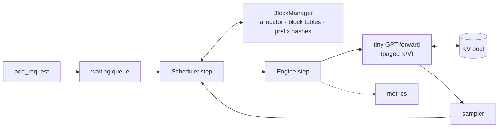

<div align="center">

# pico-vllm

**A GPT I'm building from scratch, then a mini-vLLM to serve it.**<br/>
KV cache → paged KV → continuous batching → prefix caching, in plain PyTorch on a Mac.

[](https://github.com/Analyst-Harsh/pico-vllm/actions/workflows/ci.yml)


</div>

> 🚧 **Learning in public.** I build the model and the engine session by session with Claude Code as tutor and pair programmer, following [the roadmap](docs/ROADMAP.md). The status table below shows how far I've got.

## Why

Tools like vLLM make LLM serving look like one command. I want to know what's underneath: why serving is a memory problem, how PagedAttention stores the KV cache in blocks, and how a scheduler keeps the GPU busy with requests that start and finish at different times. The best way I know to learn that is to build a small version on a model I also built.

It's a sibling of [**Fryday**](https://github.com/Analyst-Harsh/Fryday), my local Hindi voice assistant. What I learn here feeds how Fryday is served.

## Status

| Milestone | What it adds | Status |
|---|---|---|
| F4 | Character tokenizer, bigram baseline, one self-attention head | ✅ |
| F5 | Full tiny GPT trained on MPS, sampler, attention-weight inspection | ✅ |
| F6 | Llama-style changes: batched heads, RMSNorm, grouped-query attention | ✅ |
| v9.1 | KV cache | ✅ |
| v9.2 | Paged KV: block allocator, block tables | ✅ |
| v9.3 | Continuous batching: scheduler, engine loop, static-batching baseline | ✅ |
| v9.4 | Prefix caching: block hashing, ref counts | ✅ |

## Architecture (the target)



- **Tiny GPT:** a character-level transformer trained on tiny-shakespeare, following Karpathy's *Let's build GPT*.
- **KV cache and paged KV:** keys and values live in fixed-size blocks drawn from a pool, so memory isn't reserved for the longest possible reply.
- **Scheduler:** each step decides which requests run, admitting new ones as soon as blocks free up (continuous batching).
- **Prefix caching:** requests that share a prompt prefix reuse the same KV blocks.

More in [docs/DESIGN.md](docs/DESIGN.md).

## Results

Filled in as each milestone lands. Every number links to its entry in [EXPERIMENTS](docs/EXPERIMENTS.md).

| Measurement | Result |
|---|---|
| Val loss: bigram → one head → full GPT | [2.49](docs/EXPERIMENTS.md#2026-11-01-bigram-baseline-on-tiny-shakespeare-f4) → [2.41](docs/EXPERIMENTS.md#2026-11-01-one-attention-head-vs-bigram-f4) → [1.585](docs/EXPERIMENTS.md#2026-11-02-run-b-wider-gpt--ctx-64-dropout-02-vs-0-f5) |
| Static vs continuous batching (64 mixed requests, 8 slots) | [2.1× fewer steps; tokens/step 3.3 → 7.1; utilisation 41% → 89%; TTFT p50 139 → 8 steps](docs/EXPERIMENTS.md#2026-11-11-static-vs-continuous-batching-v9-b3) |
| Prefix caching (64 requests sharing a 32-token system prompt) | [hit rate 79%; prefill tokens −79%; peak pages 27 → 13; with ⅓ of the memory, 205 → 118 steps and TTFT p50 55 → 1 step](docs/EXPERIMENTS.md#2026-11-11-prefix-caching-on-a-shared-system-prompt-v9-b4) |

## Quickstart

macOS on Apple silicon (for MPS) and [uv](https://docs.astral.sh/uv/). Linux works on CPU.

```sh
make sync    # torch + dev tools + git hooks
make data    # tiny-shakespeare, checksum-verified
make test
```

## How it's built

- **Claude Code writes most of the code, at my request, then walks me through it step by step** until I can explain it back: self-attention, the GPT, the KV cache, the block allocator, the scheduler and prefix caching. I predict results before each run and ask the "why" questions.
- **Every piece is checked against a simple reference:** batched vs looped attention, cached vs recomputed generation, paged vs contiguous cache, engine vs one-request-at-a-time greedy.
- **Every measurement, including wrong predictions and negative results,** is in [EXPERIMENTS](docs/EXPERIMENTS.md).
- **The repo tooling was set up with Claude Code:** uv, ruff, pytest, lefthook and CI.

## What this isn't

Not fast and not production. It has no CUDA kernels, uses a character tokenizer and a short context, and runs as a single process. The full list, with what vLLM does instead, is in [Gaps vs vLLM](docs/DESIGN.md#gaps-vs-vllm).

## Credits

- [Andrej Karpathy, *Let's build GPT*](https://www.youtube.com/watch?v=kCc8FmEb1nY) and [ng-video-lecture](https://github.com/karpathy/ng-video-lecture)
- [Kwon et al., *Efficient Memory Management for LLM Serving with PagedAttention*](https://arxiv.org/abs/2309.06180)
- [Yu et al., *Orca*](https://www.usenix.org/conference/osdi22/presentation/yu) (iteration-level scheduling)
- [nano-vllm](https://github.com/GeeeekExplorer/nano-vllm)

## License

[MIT](LICENSE)
