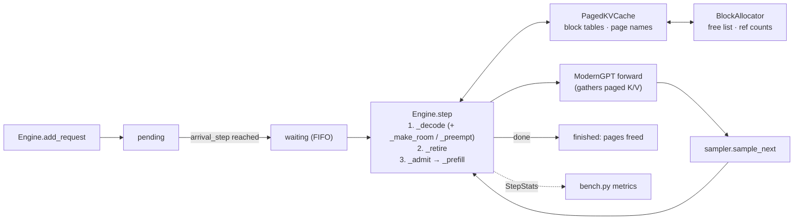

# pico-vllm design

**Goal:** understand LLM serving by building it. First a character-level GPT trained from scratch on tiny-shakespeare, then an engine that serves many requests at once on that GPT, the way vLLM does. Plain PyTorch on an Apple-silicon Mac (MPS). This repo is for understanding, not speed.

## Model (F4–F5)

| Field | Value |
|---|---|
| Tokenizer | characters, vocab 65 |
| `ctx_len` (context length) | 64 |
| `n_embd` / `n_head` / `n_layer` | 128 / 4 / 4 (head_size 32); F6 adds `n_kv_head` |
| Parameters | 816,705 (`gpt-m-nodrop`, matched by hand); 750,017 with GQA n_kv 2 |
| Val loss | 1.585 (`gpt-m-nodrop`); 1.57–1.58 for the F6 variants → [EXPERIMENTS](EXPERIMENTS.md) |

## KV memory math (v9 learn 1)
```
KV bytes per token = 2 × n_layer × n_kv_head × head_size × dtype_bytes
                     │    │          │           │            └ 4 fp32, 2 bf16/fp16, 1 int8/fp8
                     │    │          │           └ numbers per head vector
                     │    │          └ k/v heads (= n_head for MHA, fewer for GQA, 1 for MQA)
                     │    └ every layer keeps its own cache
                     └ one k and one v
KV bytes per sequence = KV bytes per token × tokens (prompt + generated so far)
```

**Our GPT** (4 layers, head_size 32, fp32, `ctx_len` 64):

| Attention | n_kv_head | Per token | Per sequence at 64 tokens | Sequences in 100 MB |
|---|---|---|---|---|
| MHA (`gpt-m-nodrop`, `gpt-m-rms`) | 4 | 2·4·4·32·4 = **4 KB** | 256 KB | ~400 |
| GQA (`gpt-m-gqa2`) | 2 | **2 KB** | 128 KB | ~800 |
| MQA (`gpt-m-gqa1`) | 1 | **1 KB** | 64 KB | ~1,600 |

The weights are 816,705 × 4 B ≈ 3.3 MB, so ~13 full sequences of MHA cache already outweigh the model. Serving memory is cache memory.

**Real-model reference: Qwen3-4B** (Fryday's model; HF `config.json`: 36 layers, 32 query heads, 8 k/v heads, head_dim 128, bf16, max 40,960 positions):

| | Per token | 4K-token sequence | Full 40,960-token sequence |
|---|---|---|---|
| As shipped (GQA, 8 k/v) | 2·36·8·128·2 = **144 KB** | 576 MB | 5.6 GB |
| If it were MHA (32 k/v) | 576 KB | 2.3 GB | 22.5 GB |

Decode reads the whole cache every step, so this size sets both how many sequences fit (B2, B3) and how fast each token is (memory-bound).

## Engine (v9)



| Component | Job | File |
|---|---|---|
| `Sequence` | a request's tokens, state (PENDING → WAITING → RUNNING → FINISHED; preempted → WAITING) and step stamps | [`serving/sequence.py`](../src/pico_vllm/serving/sequence.py) |
| `BlockAllocator` | free list of KV pages (oldest freed first), ref counts, `share` | [`serving/block_allocator.py`](../src/pico_vllm/serving/block_allocator.py) |
| `PagedKVCache` | block table per sequence; page names → blocks for prefix reuse | [`serving/paged_kv_cache.py`](../src/pico_vllm/serving/paged_kv_cache.py) |
| `Engine.step` | decode → retire → admit FIFO within the page and `max_num_seqs` budget; preempt the newest when out of pages | [`serving/engine.py`](../src/pico_vllm/serving/engine.py) |
| `Engine` | requests in, `step()` until done, per-step stats | [`serving/engine.py`](../src/pico_vllm/serving/engine.py) |
| Sampler | temperature, top-k, greedy | [`sampler.py`](../src/pico_vllm/sampler.py) |
| Metrics | see below | [`bench.py`](../src/pico_vllm/bench.py) |

## Metrics (v9 learn 3)
One request: `arrival │ queue │ prefill │ tok1 │ tok2 │ … │ tokN`. **TTFT** = arrival → tok1, **TPOT** = gap between tokens, **E2E** = TTFT + (N−1)·TPOT.

On MPS, wall-clock time for this tiny model is mostly launch overhead (EXPERIMENTS 2026-11-10), so the engine is measured in **steps** first. One step = one `Engine.step()` = one batched decode forward over the running sequences (plus a prefill per newcomer).

| Metric | Definition (ours) | Production equivalent | Build |
|---|---|---|---|
| TTFT | steps from `add_request` to its first output token | ms; queue wait + prefill | B3 |
| TPOT | decode steps per output token after the first (1.0 when never preempted or paused) | ms per token; decode step time | B3 |
| tokens/step | output tokens produced in a step, averaged over the run | tokens/s throughput | B3 |
| batch utilisation | running sequences ÷ `max_num_seqs`, averaged over steps | GPU busy fraction | B3 |
| padding waste | static batching: slots spent on finished or padded sequences ÷ all slots | — (what continuous batching removes) | B3 |
| KV block usage | blocks in use ÷ `num_blocks`; plus preemptions, if implemented | KV cache usage % in vLLM's metrics | B2, B3 |
| prefix-cache hit rate | prompt tokens served from shared blocks ÷ all prompt tokens | same | B4 |
| goodput | requests meeting a TTFT and TPOT budget (in steps) ÷ all requests | throughput within the SLO | B3 |
| wall-clock | real seconds, always labelled **indicative** | ms | all |

**Rules:** report p50 and p99, never only the mean. Every run uses `bench.py`'s seeded workload. Sizing check (Little's law): in-flight sequences = arrival rate × steps per request, and each one holds its KV blocks.

## Gaps vs vLLM
What a production engine does that this one doesn't. In the code, each one is marked with a `# Simplification:` comment.

| Gap | What production does | What we do | Why / when it matters | Talking point | Added |
|---|---|---|---|---|---|
| Attention kernel | fused PagedAttention CUDA kernel | torch gather on MPS | learning the memory layout, not speed | "The block table is the idea; the kernel is an optimisation of the gather." | setup |
| Scheduler overhead | CUDA graphs, overlap of CPU scheduling with GPU work | plain Python each step | only matters at real throughput | where the step time goes | setup |
| GQA k/v sharing | the kernel indexes k/v head `i // group` straight from the cache, no copy | no k/v copy (query groups folded into rows, F6), but plain torch ops: scores, mask, softmax and `@ v` are separate kernels | a fused kernel does it in one pass; matters at decode throughput | "GQA saves cache memory *and* bandwidth, but only if the kernel never materialises the repeat." | F6 |
| Preemption | swap or recompute when memory runs out | recompute: free the newest sequence's pages, requeue it at the front, re-prefill prompt + output later (B3); no swap | long-tail requests | vLLM's recompute vs swap choice | setup |
| Chunked prefill | splits long prompts across steps and batches prefills with decodes | whole prefill in one step, one forward per newcomer, separate from the batched decode | TTFT for other requests | prefill/decode interference | setup |
| Prefix-cache hashing | strong hash of parent name + tokens (vLLM: optional SHA-256); linked free list for O(1) revive | Python `hash` of a tuple; `deque.remove` to revive a freed block (O(num_blocks)) | collisions would read another request's KV; scan cost grows with the pool | why the name chains the parent's name, and why the hash must be strong | B4 |
| Context length | RoPE, long context | learned position embedding, so prompt + output ≤ `ctx_len` (`max_model_len`) | the engine must enforce it | why RoPE generalises and learned embeddings don't | setup |
| Serving surface | OpenAI API server, tensor parallelism, many processes | single process, in-memory | — | how it would sit behind Fryday's OpenAI contract | setup |
| Tokenizer | BPE | characters | fine for learning | why BPE changes the KV math | setup |
| Attention heads | fused SDPA / FlashAttention: scores, mask, softmax and `@ v` in one kernel | heads are a tensor dimension since the Llama-style step (`CausalSelfAttention`, `GroupedQueryAttention`), but attention is plain torch ops; the GPT-2-style `GPT` still loops over `Head` modules for teaching | 8 looped heads took 2× the wall time of 4 at equal params (EXPERIMENTS 2026-11-02) | why real code reshapes to a head dimension and fuses the kernel | F5 |
| Type checking | strict type checker in CI | ruff only (torch types fight strict pyright) | low risk at this size | where types earn their keep | setup |
