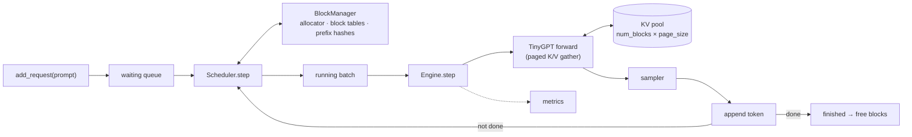

# pico-vllm design

**Goal:** understand LLM serving by building it. First a character-level GPT trained from scratch on tiny-shakespeare, then an engine that serves many requests at once on that GPT, the way vLLM does. Plain PyTorch on an Apple-silicon Mac (MPS). This repo is for understanding, not speed.

## Model (F4–F5)

| Field | Value |
|---|---|
| Tokenizer | characters, vocab 65 |
| `ctx_len` (context length) | TBD |
| `n_embd` / `n_head` / `n_layer` | TBD |
| Parameters | TBD (hand-calculated, then checked) |
| Val loss | TBD → [EXPERIMENTS](EXPERIMENTS.md) |

## KV memory math (v9 learn 1)
TBD: bytes per token = 2 × n_layer × n_kv_heads × head_dim × dtype bytes.

## Engine (v9)

| Component | Job | Status |
|---|---|---|
| `Sequence` | a request's tokens and state: WAITING → RUNNING → FINISHED | planned (B3) |
| `BlockAllocator` | free list of KV blocks; later ref counts | planned (B2) |
| `BlockManager` | block table per sequence; prefix-hash map | planned (B2, B4) |
| `Scheduler.step` | which sequences run this step, within the block and `max_num_seqs` budget | planned (B3) |
| `Engine` | loop: schedule → build batch → forward → sample → append → free | planned (B3) |
| Sampler | temperature, top-k | planned (F5) |
| Metrics | see below | planned (B3) |

## Metrics (v9 learn 3)
TBD: TTFT and TPOT (in steps), tokens/step, batch utilisation, padding waste, prefix-cache hit rate.

## Gaps vs vLLM
What a production engine does that this one doesn't. Same columns as Fryday's `production-gaps.md`.

| Gap | What production does | What we do | Why / when it matters | Talking point | Added |
|---|---|---|---|---|---|
| Attention kernel | fused PagedAttention CUDA kernel | torch gather on MPS | learning the memory layout, not speed | "The block table is the idea; the kernel is an optimisation of the gather." | setup |
| Scheduler overhead | CUDA graphs, overlap of CPU scheduling with GPU work | plain Python each step | only matters at real throughput | where the step time goes | setup |
| GQA k/v sharing | the kernel indexes k/v head `i // group` straight from the cache, no copy | no k/v copy (query groups folded into rows, F6), but plain torch ops: scores, mask, softmax and `@ v` are separate kernels | a fused kernel does it in one pass; matters at decode throughput | "GQA saves cache memory *and* bandwidth, but only if the kernel never materialises the repeat." | F6 |
| Preemption | swap or recompute when memory runs out | reject or wait (recompute is a stretch goal) | long-tail requests | vLLM's recompute vs swap choice | setup |
| Chunked prefill | splits long prompts across steps | whole prefill in one step | TTFT for other requests | prefill/decode interference | setup |
| Context length | RoPE, long context | learned position embedding, so prompt + output ≤ `ctx_len` (`max_model_len`) | the engine must enforce it | why RoPE generalises and learned embeddings don't | setup |
| Serving surface | OpenAI API server, tensor parallelism, many processes | single process, in-memory | — | how it would sit behind Fryday's OpenAI contract | setup |
| Tokenizer | BPE | characters | fine for learning | why BPE changes the KV math | setup |
| Attention heads | all heads in one batched matmul: q, k, v shaped `(B, n_head, T, head_size)`, fused SDPA / FlashAttention | a Python loop over `Head` modules, then `torch.cat` | 8 heads took 2× the wall time of 4 at equal params (EXPERIMENTS 2026-11-02); per-step overhead in v9 | why real code reshapes to a head dimension instead of looping | F5 |
| Type checking | strict type checker in CI | ruff only (torch types fight strict pyright) | low risk at this size | where types earn their keep | setup |

## vLLM mapping (v9 B5)
TBD: vLLM class or function → ours.
